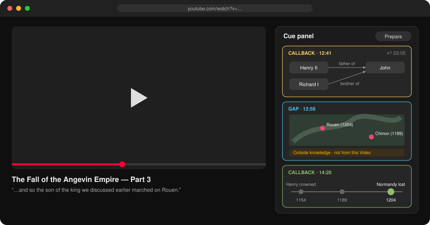
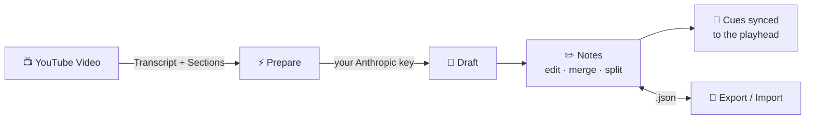

# 🎬 Cue

**Context beside YouTube videos, right when the narration assumes you have it.**



## How it works



| Cue | When | Shows |
| --- | --- | --- |
| 🔁 **Callback** | Narration refers back to someone/something from earlier | 👥 Relationship card · 🗺️ Map · 📅 Timeline |
| 🕳️ **Gap** | Narration assumes context the Video never gives | Same visuals, with **Outside knowledge** clearly labelled |

## Install

```text
1. chrome://extensions  →  Developer mode ON
2. Load unpacked        →  this folder
3. Extension options    →  paste your Anthropic API key
4. Open a YouTube video →  click Prepare
```

> 🔒 No server. Your key and Notes stay in your browser; the Transcript goes only to `api.anthropic.com` when you click **Prepare**.

## Develop

```sh
npm test
```

📖 Terms: [GLOSSARY.md](GLOSSARY.md) · Decisions: [docs/adr](docs/adr)
